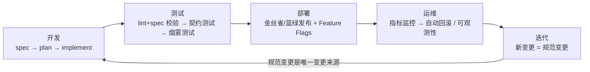

> **SDD + Harness 四周学习计划 · Week 3 · Day 21（工程化闭环收官课 / 全计划第 3 个复盘日）**
>
> 今日主题：**周复盘**：梳理开发/测试/部署/运维/迭代五阶段闭环图，写案例笔记
>
> 建议用时：90 分钟 ｜ 前置：Day 20 的端到端实操 + Week 3 全部讲义
>
> 输出物：**五阶段闭环图** + **一篇案例笔记（基于 Day 20）** + 复习题自测

---

## 0. 一句话剧透

Week 3 收官，不学新的。做三件事：**串**（Day 15–20 各一句话）、**画**（开发/测试/部署/运维/迭代五阶段闭环图）、**写**（基于 Day 20 端到端实操的案例笔记）。今天这张闭环图和这篇笔记，就是你 Week 3 的结业作品，也是 Week 4 沉淀模板的原料。

---

## 1. 今日目标（学完你能做到）

- [ ] 不看讲义，能把 Day 15–20 各用一句话串成认知地图
- [ ] 能画出五阶段闭环图（开发/测试/部署/运维/迭代）并讲清「规范变更是唯一变更来源」
- [ ] 基于 Day 20 实操写一篇 ≥500 字案例笔记（做了什么/哪里失败/证据链是否完整）
- [ ] 完成 10 道复习题自测（答不上来能指出回看哪一天）

---

## 2. 学习动线（复盘专用时间盒）

| 步骤 | 内容 | 用时 |
|---|---|---|
| 1 | 第 3 节：Week 3 认知地图（先默写再对照） | 10 分钟 |
| 2 | 第 4 节：五阶段闭环图（自己画再对照） | 20 分钟 |
| 3 | 第 5 节：规范变更是唯一变更来源 | 10 分钟 |
| 4 | 第 6 节：写案例笔记 | 25 分钟 |
| 5 | 第 7 节：复习题自测 | 15 分钟 |
| 6 | 打卡收尾 | 10 分钟 |

---

## 3. Week 3 认知地图：Day 15–20 一句话串讲

先默写，再对照下表：

| 天 | 一句话 |
|---|---|
| Day 15 | 四类契约把「完成」拆成可工程化的边界：数据（Schema）/ 行为（API 边界/异常）/ 质量（延迟/吞吐/准确性）/ 可观测性（日志/指标/追踪） |
| Day 16 | 规范即代码、规范即测试：spec 直接长出骨架代码、契约测试、Mock——测试从规范生成，门禁才可信 |
| Day 17 | 持续交付中的 Harness：CI/CD + 金丝雀/蓝绿 + Feature Flags + 质量门禁五步 + 自动回滚 |
| Day 18 | 实操：把 Day 5 的 AC 转写成 Gherkin（Given/When/Then）——验收从文字变成可执行 |
| Day 19 | 三大挑战：规范演进（Git 单一事实来源）/ AI 不确定性（语义等价类/置信度阈值/回退）/ 权重管理（镜像分层） |
| Day 20 | 实操：spec → plan → implement → verify → merge 全链路，六样证据齐备的 PR |

**串起来的逻辑链**：契约定义完成（15）→ 规范长出测试（16）→ 测试成为发布门禁（17）→ 亲手把验收转成测试（18）→ 真实世界的三个坎与对策（19）→ 带证据链地交付一个功能（20）→ **今天：把这周串成一张闭环图（21）**。

---

## 4. 五阶段闭环图（今天的核心交付）

五阶段闭环（已核验）：**开发 / 测试 / 部署 / 运维 / 迭代**。**规范变更是唯一变更来源，变更触发新一轮 CI/CD。**



如果环境不支持渲染 Mermaid，用 ASCII 版本（等效）：

```
        ┌──────────────┐
        │    开发       │  spec → plan → implement（规范变更触发）
        └──────┬───────┘
               ▼
        ┌──────────────┐
        │    测试       │  lint+spec 校验 → 契约测试 → 烟雾测试
        └──────┬───────┘
               ▼
        ┌──────────────┐
        │    部署       │  金丝雀 / 蓝绿发布 + Feature Flags
        └──────┬───────┘
               ▼
        ┌──────────────┐
        │    运维       │  指标监控 → 自动回滚 / 可观测性
        └──────┬───────┘
               ▼
        ┌──────────────┐
        │    迭代       │  新变更 = 规范变更
        └──────┬───────┘
               │
               └──▶ 回到「开发」（规范变更是唯一变更来源）
```

**自检三问**：
1. 我的 Day 20 实操对应了图里哪几格？（至少开发 + 测试；部署/运维可按真实程度标「未做/模拟」）
2. 我的功能从「迭代」再进「开发」时，变更入口是规范吗？（如果不是，说明还在 Vibe Coding）
3. 自动回滚在我图里有没有触发点？（Day 17 学的，要画进去）

---

## 5. 规范变更是唯一变更来源——闭环的发动机

五阶段闭环能转起来的唯一燃料是：**变更从规范开始**。没有规范变更的代码改动，是 Week 2 hook 要拦截的「裸改」；规范变更会触发新一轮 CI/CD，测试从规范生成，所以每一轮循环都是「先立契约，再改实现」。

对照 Day 20：你从 Day 5 spec 出发（规范已存在），实现 + 测试 + 合入，实际已走完「开发 → 测试」两格；如果部署/运维没做，用「待核验/未做」标注而不是假装做了——**诚实标注也是证据**。

---

## 6. 写案例笔记（基于 Day 20，≥500 字）

模板（沿用 Week 1 的「预期 → 观测 → 复盘」三件套，加一节证据清点）：

```
# Week 3 案例笔记：<功能名> 端到端交付

## 一、做了什么
- 功能：____（来自 Day5-spec）
- 全链路：spec → plan → implement → verify → merge，各一步证据是否齐备（逐项勾）

## 二、证据清点
- [ ] spec 文件（进仓）  [ ] plan.md  [ ] tasks
- [ ] 代码 diff        [ ] verify 结果  [ ] merge 记录

## 三、预期（我以为）
我以为今天最卡的是____，结果____

## 四、观测（实际发生）
- AI 在哪里猜错：____
- spec 哪里不清楚：____（翻 Day 18 的「最卡记录」对照）
- harness 哪里没拦住：____（hook 拦截了几次？SH_SDD_SKIP 用了吗？）

## 五、复盘（新认知）
- 五阶段闭环里我最薄弱的一环：____
- 它教会我：____
- Week 4 沉淀模板时我要带走的问题：____
```

---

## 7. 复习题（10 题，覆盖 Week 3）

1. 四类契约是哪四类？各自一句话。
2. 「规范即代码、规范即测试」各是什么意思？
3. 质量门禁五步的顺序？
4. 金丝雀发布和蓝绿发布的区别？
5. Feature Flags 在 AI 应用里能配置即发布什么？
6. 自动回滚的触发与动作？
7. 三大挑战与各自对策？
8. Gherkin 三关键字与「Then 里不能有形容词」的原因？
9. 五阶段闭环是哪五阶段？「唯一变更来源」指什么？
10. 用一句话回答：Week 3 的「从能跑到可控」，可控到底指什么？

> **答案与提示**：
> 1. 数据（Schema）/ 行为（API 边界/异常）/ 质量（延迟/吞吐/准确性）/ 可观测性（日志/指标/追踪）。
> 2. 规范即代码：规范是代码生成与校验的输入；规范即测试：规范是测试生成的输入（契约测试/Mock）。
> 3. lint+spec 校验 → 契约测试 → 烟雾测试 → 金丝雀验证 → 生产前人工 approval。
> 4. 蓝绿两套环境整体切换；金丝雀渐进放量（如 10% 流量 30 分钟对比指标）。
> 5. 模型版本、Prompt 模板、推理参数。
> 6. 指标异常 → 自动回退到上一稳定版本。
> 7. 规范演进 → Git 单一事实来源；AI 不确定性 → 语义等价类/置信度阈值/回退策略；权重管理 → 镜像分层 + 版本号关联。
> 8. Given/When/Then；形容词不可执行，必须换成数字与判定规则才能成为自动化断言。
> 9. 开发/测试/部署/运维/迭代；规范变更是唯一变更来源，变更触发新一轮 CI/CD。
> 10. 提示：可控 = 完成有契约定义、验收有测试执行、发布有门禁与回滚、变更全程有证据可追溯。（参考 Day 15–20 任意一天都能展开）

---

## 延伸阅读

- 腾讯云《SDD 规范驱动 + Harness：AI 全栈开发从「能跑」到「可控」》（本周主文，五阶段闭环出处）：https://cloud.tencent.com/developer/article/2703349
- 腾讯云《出码率 90% 却没提效？》（转型动因回顾）：https://cloud.tencent.com/developer/article/2669269
- 掘金《AI 编程可闭环协作·卷三：Harness 与 SDD》：https://juejin.cn/post/7647333934796537919

---

*本工作纸依据《SDD+Harness四周学习计划.md》Day 21 主题编制。整理日期：2026-09-09*
